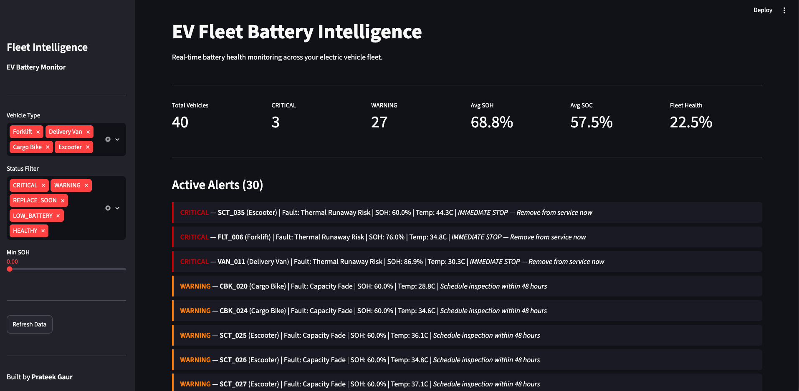
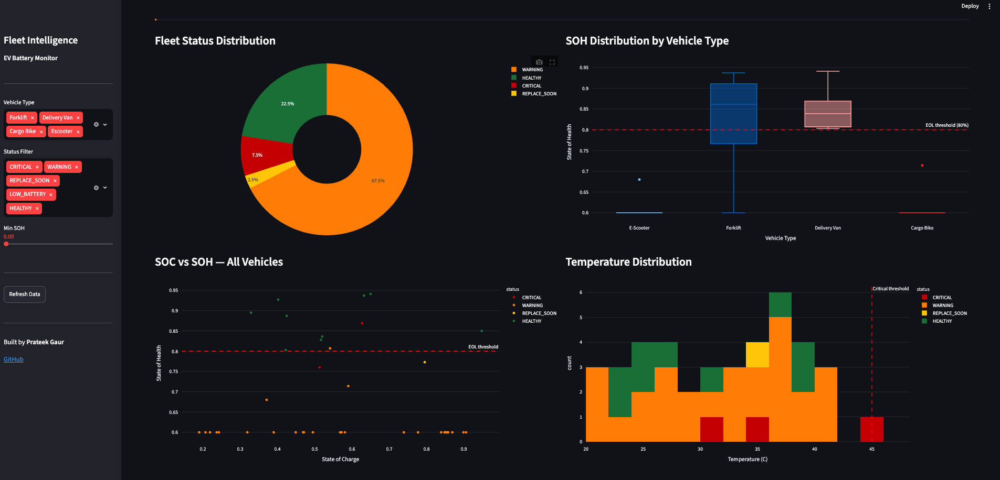
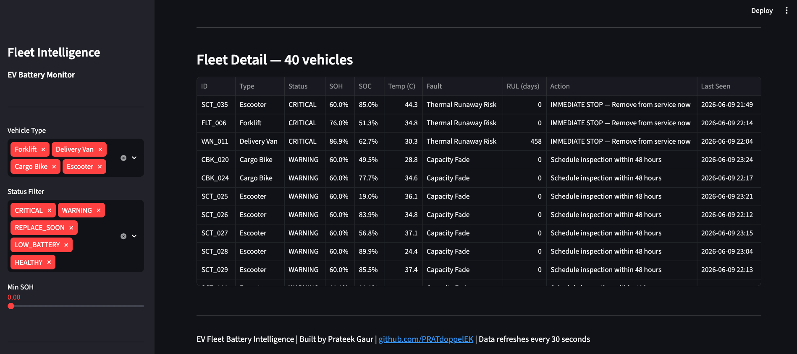

# EV Fleet Battery Intelligence

Battery health monitoring dashboard for electric vehicle fleets, running on a fleet simulator.
Monitors forklifts, delivery vans, cargo bikes, and e-scooters.







Built by Prateek Gaur — Forward Deployment Engineer | Battery Systems | AI
Portfolio: https://prateek-gaur-ml-bz0s69q.gamma.site
GitHub: https://github.com/PRATdoppelEK

---

> **📌 About this repo:** This is a showcase repo — write-up, architecture, and results only. The full implementation lives in a private core repo (kept private to protect the code and as a backup) and is available for a live walkthrough on request, e.g. in an interview.

---

## What This Is

A battery fleet intelligence prototype that shows fleet operators the health of
every battery in their fleet. The demo runs on simulated data for 40 vehicles.

No more discovering a failed forklift battery at the start of a shift.
No more unexpected delivery van breakdowns mid-route.
No more replacing batteries too early or too late.

---

## Demo — What You See

The dashboard shows:
- Live fleet status overview (Critical / Warning / Healthy counts)
- Active alerts with recommended action for each vehicle
- SOH distribution per vehicle type with EOL threshold line
- SOC vs SOH scatter plot to identify battery patterns
- Temperature distribution with thermal risk zones
- Full fleet table with sortable columns and maintenance actions

---

## Quick Start

Step 1 — Install dependencies
```
pip3 install streamlit plotly pandas numpy scikit-learn --break-system-packages
```

Step 2 — Run the dashboard
```
python3 run.py
```

Step 3 — Open browser at http://localhost:8501

For terminal-only mode (no browser needed):
```
python3 run.py --terminal
```

---

## Vehicle Types Simulated

| Type | Count | Battery | Cycles/Day | Typical Use |
|------|-------|---------|------------|-------------|
| Electric Forklift | 8 | 48V 500Ah | 2 | Warehouse operations |
| Delivery Van | 6 | 400V 200Ah | 1 | Last-mile delivery |
| Cargo Bike | 10 | 48V 15Ah | 3 | Urban delivery |
| E-Scooter | 16 | 48V 7Ah | 4 | Micro-mobility |

Total fleet: 40 vehicles

---

## Status Definitions

| Status | Meaning | Action |
|--------|---------|--------|
| CRITICAL | Thermal runaway risk or severe fault | Remove from service immediately |
| WARNING | Cell degradation or resistance fault | Inspect within 48 hours |
| REPLACE_SOON | SOH below 80% threshold | Plan replacement within 30 days |
| LOW_BATTERY | SOC below 15% | Return to charging station |
| HEALTHY | Operating within normal parameters | No action required |

---

## Technical Background

SOH (State of Health): ratio of current capacity to rated capacity.
Standard end-of-life threshold: SOH = 80%.
Estimation method: capacity fade model based on total cycles and degradation rate.

SOC (State of Charge): current energy level 0-100%.
Estimation method: Coulomb counting with temperature-corrected OCV.

Anomaly detection: robust deviation (median / MAD) from the fleet of the same vehicle type for
resistance and temperature, plus SOH compared with what the cycle count predicts. Status is decided
from telemetry only; the simulator's injected fault is kept just to measure detection.
On 50 simulated fleets, 93% of injected faults are flagged, with alerts on about 1% of vehicles
that have no injected fault (`python run.py --terminal` prints the check).

This project builds on the author's M.Sc. thesis (Custom Battery Cell Balancing
Under Thermal Gradient, TU Berlin) and industrial experience at Dan-Tech Energy GmbH
(battery degradation analysis).

---

## Repository Structure

```
ev-fleet-battery-intelligence/
|-- data/
|   |-- simulator.py        # Realistic fleet data generator
|-- models/
|   |-- health_analyzer.py  # SOH analysis, RUL estimation, alert logic
|-- dashboard/
|   |-- app.py              # Streamlit web dashboard
|-- reports/
|   |-- report_generator.py # Automated fleet health report
|-- docs/
|   |-- fde-deployment-guide.md  # How to deploy at a real customer
|-- run.py                  # Single entry point
|-- requirements.txt
```

---

## Related Projects

- battery-soh-lstm: LSTM model for SOH prediction (MAE 0.0057, R² 0.96 on synthetic data)
- battery-ecm-simulation: Python ECM with 14S3P pack simulation
- battery-digital-twin: Full MLOps pipeline with Kubernetes and drift monitoring

---

## 📬 Contact

**Prateek Gaur** — Forward Deployment Engineer | Battery Systems | AI Enablement  
📧 prateekgaur@gmx.de  
🌐 [Portfolio](https://prateek-gaur-ml-bz0s69q.gamma.site)  
💼 [LinkedIn](https://linkedin.com/in/prateek-gaur-15a629b4)  
🐙 [GitHub](https://github.com/PRATdoppelEK)

---

*See also:*  
[`battery-soh-lstm`](https://github.com/PRATdoppelEK/battery-soh-lstm) · 
[`battery-ecm-simulation`](https://github.com/PRATdoppelEK/battery-ecm-simulation) · 
[`battery-digital-twin`](https://github.com/PRATdoppelEK/battery-digital-twin)
